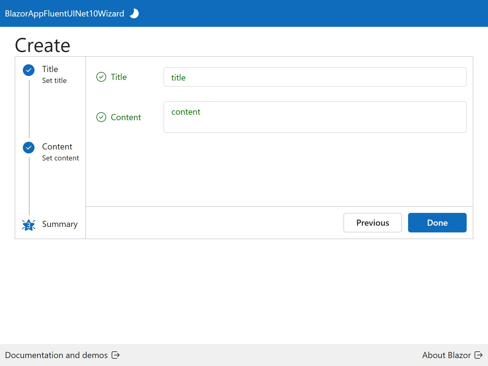
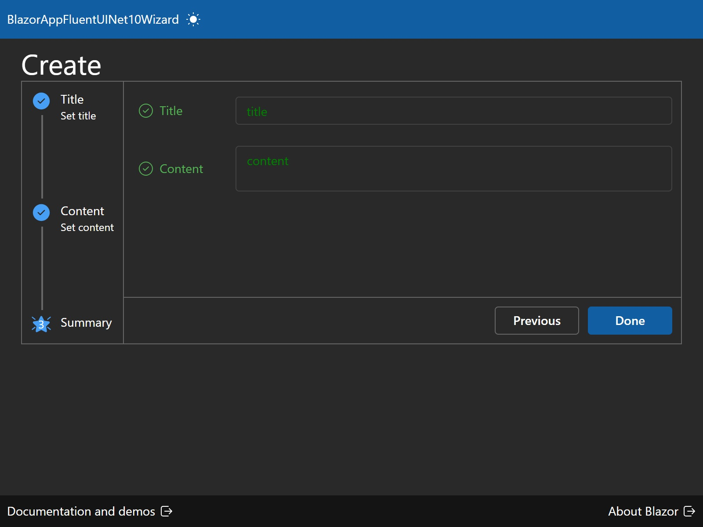

<p class="d-flex justify-content-center">
<br>
</p>


#### **Blazor Fluent UI .NET 10 Wizard**

| Light | Dark |
| -------- | ------- |
|  |  |


.NET 10: ```.NET 10``` introduces several enhancements, including performance improvements, new APIs, and better support for cloud-native applications. The integration of JSON schema extraction in .NET 10 is a significant feature that aids in data validation and API documentation.

Blazor: ```Blazor``` is a web framework that allows developers to build interactive web applications using C# instead of JavaScript. It leverages the power of .NET to create rich client-side applications that can run in the browser via WebAssembly or on the server.

Fluent UI Blazor: ```Fluent UI Blazor``` is a set of components that implement Microsoft's Fluent Design System for Blazor applications. It provides a consistent and modern user interface, enhancing the overall user experience.

Wizard Component: ```Wizard Component``` A multi-step interface that guides users through a process, ensuring that all necessary information is collected in a structured manner.


##### **Create.razor**

{}
{}{}
{}


Wizard consists of three steps, ```Title```, ```Content```, and ```Summary```. This step allows the user to ```input``` the title of the blog post. It uses ```data binding``` to connect the ```input field``` to the ```blogPostViewModelFormData1.Title``` property. Users can enter the content of the blog post. It employs data binding for the ```content input```. ```Summary step``` displays the title and content entered by the user in a ```read-only format```, allowing for a ```final review``` before submission. ```OnFinishedAsync``` method handles the final submission of the blog post, mapping the ```view model``` to the actual blog post entity and calling the service to save it.


#### **Source**
Full source code is available at this repository in GitHub:  
https://github.com/akifmt/DotNetCoding/tree/main/src/BlazorAppFluentUINet10Wizard  
