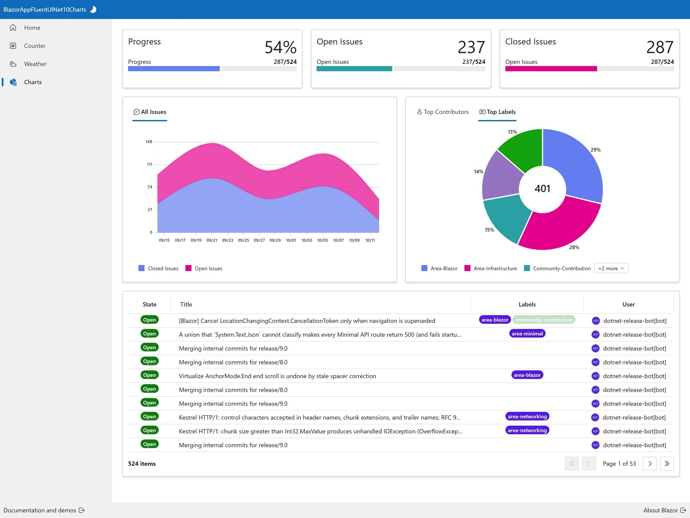
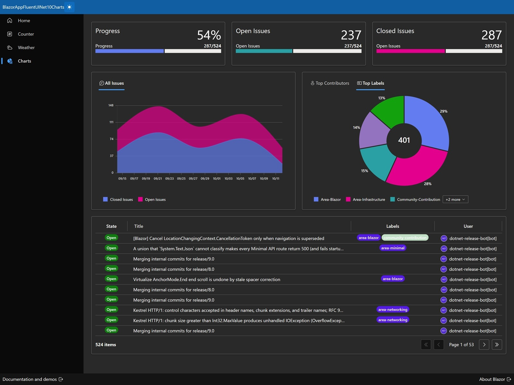

<p class="d-flex justify-content-center">
<br>
</p>


#### **Blazor Fluent UI .NET 10 Charts**

| Light | Dark |
| -------- | ------- |
|  |  |


.NET 10: ```.NET 10``` introduces several enhancements, including performance improvements, new APIs, and better support for cloud-native applications. The integration of JSON schema extraction in .NET 10 is a significant feature that aids in data validation and API documentation.

Blazor: ```Blazor``` is a web framework that allows developers to build interactive web applications using C# instead of JavaScript. It leverages the power of .NET to create rich client-side applications that can run in the browser via WebAssembly or on the server.

Fluent UI Blazor: ```Fluent UI Blazor``` is a set of components that implement Microsoft's Fluent Design System, allowing developers to create visually appealing and consistent user interfaces in Blazor applications. It provides a rich set of UI components that are easy to use and integrate seamlessly with Blazor.

Charts: ```Charts``` visual representations of data that help users interpret information quickly.


##### **Charts.razor**

{}
{}{}
{}


```Charts.razor``` serves as the main view for visualizing issue tracking data. ```All Issues By Date (Area Chart)```, first card hosts a tabbed interface. The default tab shows an ```FluentAreaChart``` tracking issue counts over time ```(dataAllIssuesByDateAreaChart)```. ```Top Contributors & Top Labels (Donut Charts)```, second card also uses tabs, ```Top Contributors``` shows how many issues are associated with the top 7 users ```(dataTopContributorsDonutChart)```.
```Top Labels``` shows the most frequently used labels ```(dataTopLabelsDonutChart)```. final section displays a detailed, paginated list of all issues. It uses ```FluentDataGrid``` to display structured data. The ```"State"``` and ```"Labels"``` columns use ```TemplateColumns``` because they require custom rendering logic.


##### **GithubService.cs**

{}
{}{}
{}


```GetIssues``` is the primary public method users should call. It aims to retrieve all issues for a given date. It calculates a target date ```(target = date.AddMonths(-1))```. After fetching, it filters and orders the results. It keeps only issues where ```CreatedAt``` is on or after the calculated target date. It sorts them by their creation date ```(OrderBy(issue => issue.CreatedAt))```. Finally, it returns the ```filtered``` list of issues.  

```FetchIssues``` method handles the actual network communication and pagination loop. It takes a starting date (since) for the API query. Initializes an empty ```List<Issue>``` called issues, uses a HttpClient to make requests. It builds the initial ```GET request URL```, targeting the ```GitHub API``` for issues in the dotnet/aspnetcore repository. It specifies fetching up to 100 items per page ```(per_page=100)``` and includes the since parameter. It sends the request and checks if the status code is successful ```(response.IsSuccessStatusCode)```.


#### **Source**
Full source code is available at this repository in GitHub:  
https://github.com/akifmt/DotNetCoding/tree/main/src/BlazorAppFluentUINet10Charts  
